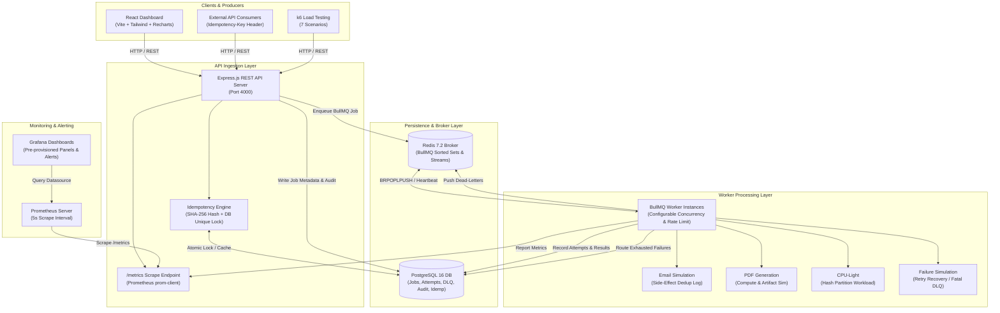

# QueueFlow: Distributed Job Processing System

QueueFlow is a production-grade, fault-tolerant distributed background job processing system built with **Node.js**, **TypeScript**, **Express.js**, **BullMQ**, **Redis**, **PostgreSQL (Prisma ORM)**, and **React**.

It implements decoupled API and worker runtimes, idempotency guarantees via database constraints and deterministic payload hashing, automated exponential backoff with jitter, durable Dead-Letter Queue (DLQ) state persistence with administrative replay workflows, Prometheus/Grafana observability, and k6 load-testing suites.

---

## 1. System Architecture



---

## 2. Technology Stack

- **Backend:** Node.js v22+, TypeScript 5, Express.js 4, Helmet, CORS
- **Job Queue & Broker:** BullMQ 5, Redis 7 (ioredis)
- **Database & ORM:** PostgreSQL 16, Prisma ORM 6
- **Frontend Dashboard:** React 18, TypeScript, Vite, Tailwind CSS, Recharts, Lucide Icons
- **Validation:** Zod schemas for all job payloads, queries, and replay commands
- **Metrics & Observability:** Prometheus (`prom-client`), Grafana dashboard provisioning
- **Load Testing:** k6 (7 specialized scenarios)
- **Testing:** Vitest, Supertest
- **Containerization:** Docker multi-stage builds and Docker Compose

---

## 3. Directory Layout

```
.
├── backend/
│   ├── src/
│   │   ├── api/             # Express server, routes, controllers, middleware
│   │   ├── config/          # Environment & cluster configuration
│   │   ├── database/        # Prisma client singleton & connection health
│   │   ├── errors/          # Custom error hierarchy (Retryable vs NonRetryable)
│   │   ├── logger/          # Structured JSON logger (Pino)
│   │   ├── metrics/         # Prometheus prom-client metrics registry
│   │   ├── queues/          # BullMQ queue definitions & connection pooling
│   │   ├── services/        # Job, Idempotency, DLQ, Stats, Audit, Side-Effect
│   │   ├── types/           # Domain schemas & interfaces
│   │   ├── validation/      # Zod validation schemas
│   │   └── workers/         # BullMQ worker processor & job workload handlers
│   ├── prisma/              # Prisma schema, migrations, seed script
│   ├── tests/               # Vitest unit & integration test suites
│   ├── Dockerfile.api       # Multi-stage production API image
│   └── Dockerfile.worker    # Multi-stage production Worker image
├── frontend/
│   ├── src/
│   │   ├── api/             # Typed API client
│   │   ├── components/      # StatsOverview, QueueCharts, JobsTable, DLQ, Modals
│   │   ├── types/           # Frontend TypeScript types
│   │   └── App.tsx          # Real-time polling monitoring dashboard
│   ├── Dockerfile           # Multi-stage Nginx SPA container
│   └── vite.config.ts       # Vite build & proxy configuration
├── docker/
│   ├── prometheus/          # Prometheus configuration & alerting rules
│   └── grafana/             # Auto-provisioned datasource & dashboard JSON
├── load-tests/              # 7 executable k6 load scenarios & benchmark template
├── docker-compose.yml       # Complete multi-service orchestration
└── .env.example             # Environment configuration template
```

---

## 4. Database Schema (PostgreSQL + Prisma)

The database schema cleanly separates durable business state and audit histories from the in-memory Redis broker:

| Model | Purpose | Key Constraints |
|---|---|---|
| `Job` | Master record for every job submitted | UUID primary key, indexed on status, type, createdAt |
| `IdempotencyRecord` | Guarantees atomic deduplication of API submissions | Key primary key, requestHash SHA-256 integrity, expiresAt |
| `JobAttempt` | Detailed log of each worker execution attempt | Foreign key to Job, durationMs, errorName, errorMessage, stack |
| `JobResult` | Final computed output for completed jobs | Unique foreign key to Job, executionDurationMs, JSON data |
| `DeadLetterRecord` | Durable record for permanently failed tasks | Unique foreign key to Job, replayCount, isResolved, audit |
| `JobAuditLog` | Immutable event sourcing audit trail | Records ENQUEUED, ATTEMPT_STARTED, ATTEMPT_SUCCEEDED, RETRIED, MOVED_TO_DLQ, REPLAYED |
| `SideEffectLog` | Prevents external side-effect duplication | Unique `dedupKey` (`effectType:jobId:recipientHash`) |

---

## 5. REST API Documentation

### Job Management
- `POST /api/jobs`: Enqueue a job. Supports `Idempotency-Key` header.
- `GET /api/jobs`: Paginated list of jobs. Filterable by `status`, `type`, `search`, `startDate`, `endDate`.
- `GET /api/jobs/:id`: Fetch full job details including all attempt traces, result, and audit trail.
- `GET /api/jobs/:id/result`: Retrieve output payload for completed jobs.
- `POST /api/jobs/:id/cancel`: Cancel an enqueued or active job.

### Queue Metrics & Cluster Health
- `GET /api/queues/stats`: Real-time BullMQ broker state, database status counts, p50/p95/p99 execution percentiles, and worker health.
- `GET /health`: Liveness probe.
- `GET /ready`: Readiness probe verifying PostgreSQL and Redis connections.
- `GET /metrics`: Prometheus scraper endpoint (`text/plain`).

### Administrative Dead-Letter Queue (DLQ)
*(Requires `x-admin-key: <ADMIN_API_KEY>` or `Authorization: Bearer <ADMIN_API_KEY>`)*
- `GET /api/admin/jobs/failed`: Paginated inspection of unresolvable dead-letter jobs.
- `GET /api/admin/jobs/:id`: Deep inspection of a failed dead-letter record and its failure traces.
- `POST /api/admin/jobs/:id/replay`: Re-enqueue a failed job with reset attempt counters and audit logging.

---

## 6. Retry Policy & Failure Recovery

### 1. Exponential Backoff with Jitter
When a worker encounters a `RetryableError`, BullMQ delays the subsequent attempt using exponential backoff:
$$\text{delay} = \text{baseDelay} \times 2^{(\text{attempt} - 1)}$$

### 2. Error Classification
- **`RetryableError` (HTTP 500 equivalent):** Network timeouts, transient upstream 503 errors, rate-limit thresholds. Retried up to `maxAttempts`.
- **`NonRetryableError` (HTTP 400/422 equivalent):** Malformed input, unresolvable email address, authorization rejection. BullMQ immediately throws `UnrecoverableError` to abort remaining retries, mark the job as `FAILED`, and persist it directly into the Dead-Letter Queue.

### 3. Worker Crash Recovery (Stalled Jobs)
BullMQ workers maintain a 30-second lock duration. If a worker process crashes mid-task, other available workers detect the expired lock and recover the stalled job up to `maxStalledCount` times.

---

## 7. Idempotency & Side-Effect Deduplication

### Request Idempotency
Clients provide an `Idempotency-Key: <unique-uuid>` header.
1. QueueFlow computes a deterministic SHA-256 hash of the payload.
2. If the key exists:
   - **Matching hash:** Immediately returns the cached response status and payload without duplicating the job.
   - **Mismatched hash:** Rejects request with `409 Conflict` (`IdempotencyConflictError`).
3. Keys are stored in PostgreSQL with unique constraints and a 24-hour retention TTL.

### Side-Effect Deduplication
Queue insertion idempotency alone does not prevent duplicate external actions if a worker fails *after* making an external call but *before* writing completion state.
QueueFlow resolves this with `SideEffectService`:
- Before triggering external operations (e.g. SMTP email dispatch or third-party webhooks), the worker checks `SideEffectLog` for `dedupKey = ${type}:${jobId}:${hash}`.
- If previously executed, the external side effect is skipped and the cached transaction ID is returned.

---

## 8. Quick Start & Local Execution

### Prerequisites
- Node.js v20+ / v22+
- Docker and Docker Compose (optional for full containerization)

### Option A: Local Development Setup

1. **Install Dependencies:**
   ```bash
   cd backend && npm install
   cd ../frontend && npm install
   ```

2. **Configure Environment:**
   ```bash
   cp .env.example .env
   ```

3. **Start PostgreSQL and Redis:**
   ```bash
   docker run -d --name qf-postgres -e POSTGRES_PASSWORD=postgres -e POSTGRES_DB=queueflow -p 5432:5432 postgres:16-alpine
   docker run -d --name qf-redis -p 6379:6379 redis:7-alpine
   ```

4. **Initialize Database Schema & Seeds:**
   ```bash
   cd backend
   npx prisma migrate dev --name init
   npm run prisma:seed
   ```

5. **Run the Application:**
   ```bash
   # Terminal 1: REST API Server
   cd backend && npm run dev:api

   # Terminal 2: Background Worker Process
   cd backend && npm run dev:worker

   # Terminal 3: React Monitoring Dashboard
   cd frontend && npm run dev
   ```

6. Open `http://localhost:5173` to access the QueueFlow Monitoring Dashboard.

---

### Option B: Docker Compose Full Stack Deployment

Run all 7 services (Postgres, Redis, API, Worker, Frontend, Prometheus, Grafana) with one command:

```bash
docker-compose up --build -d
```

| Service | URL / Port | Credentials |
|---|---|---|
| React Dashboard | `http://localhost:3000` | N/A |
| REST API | `http://localhost:4000` | Admin Key: `queueflow-admin-secret-key-123` |
| Prometheus | `http://localhost:9090` | N/A |
| Grafana | `http://localhost:3001` | User: `admin`, Pass: `admin` |
| PostgreSQL | `localhost:5432` | `postgres` / `postgres` |
| Redis | `localhost:6379` | None |

---

## 9. Automated Testing

Run the test suite with Vitest:

```bash
cd backend
npm test
```

### Coverage Areas:
- `tests/unit/validation.test.ts`: Zod payload schemas, type safety, invalid payloads.
- `tests/unit/idempotency.test.ts`: Deterministic hashing, payload mutation detection.
- `tests/unit/retry-policy.test.ts`: Exponential backoff math, Retryable vs NonRetryable classification.
- `tests/unit/side-effect.test.ts`: Side-effect deduplication under crash and retry scenarios.
- `tests/integration/api-endpoints.test.ts`: Supertest validation of health, metrics, admin authorization, 422 rejections, 404 fallbacks.

---

## 10. k6 Load Testing & Benchmarking

QueueFlow includes 7 production load scenarios in `load-tests/`:

```bash
# 1. Enqueue Throughput (up to 1,000 req/sec)
k6 run load-tests/01-enqueue-throughput.js

# 2. Sustained Load (150 req/sec for 3 minutes)
k6 run load-tests/02-sustained-load.js

# 3. Spike Traffic (16x traffic burst)
k6 run load-tests/03-spike-traffic.js

# 4. Stress Test (Up to 1,000 concurrent VUs)
k6 run load-tests/04-stress-test.js

# 5. Concurrent Idempotency Key Storm
k6 run load-tests/05-idempotency-duplicate.js

# 6. Retry & Dead-Letter Queue Behavior
k6 run load-tests/06-failure-retry.js

# 7. End-to-End Execution Latency
k6 run load-tests/07-end-to-end-latency.js
```

See [BENCHMARK_REPORT_TEMPLATE.md](file:///c:/Users/prath/OneDrive/Desktop/Job%20Queue%20System/load-tests/BENCHMARK_REPORT_TEMPLATE.md) for full benchmark documentation and reporting templates.

---

## 11. Known Limitations & Security Considerations

- **Redis Memory Limits:** Redis should be configured with an appropriate `maxmemory` eviction policy (e.g., `noeviction` for BullMQ queues to prevent accidental job dropping).
- **Admin Authentication:** The administrative replay and DLQ endpoints require an API Key. For multi-tenant production deployments, integrate with OAuth2/OIDC (e.g. Auth0, Keycloak) or JWT-based RBAC.
- **Payload Sanitization:** Although Zod strictly validates input types, payloads containing unconstrained blobs should be bounded by Express body-parser size limits (currently set to 10MB).
#
